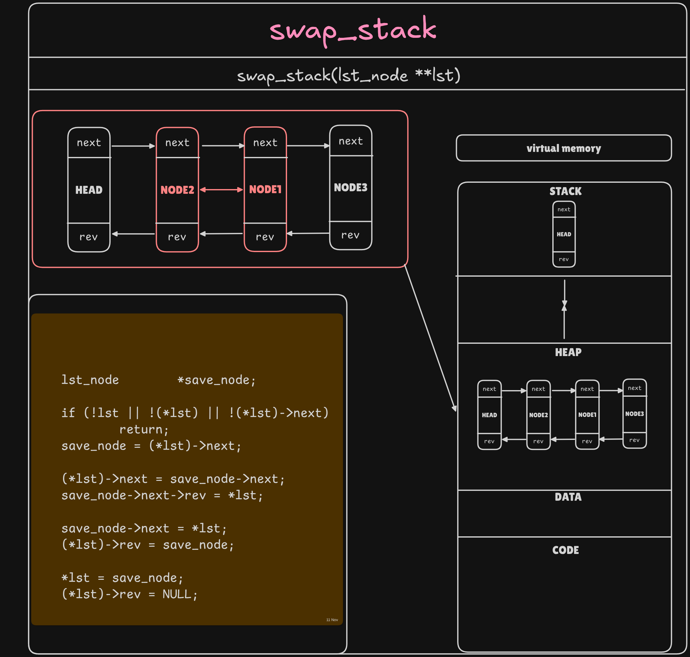
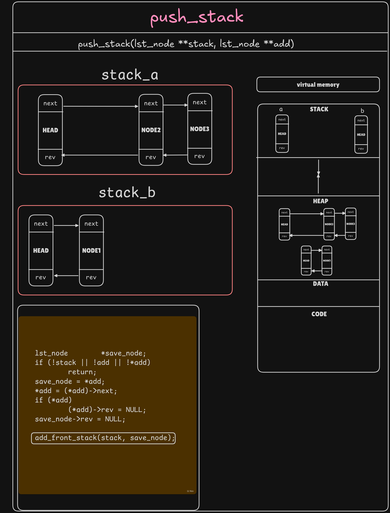
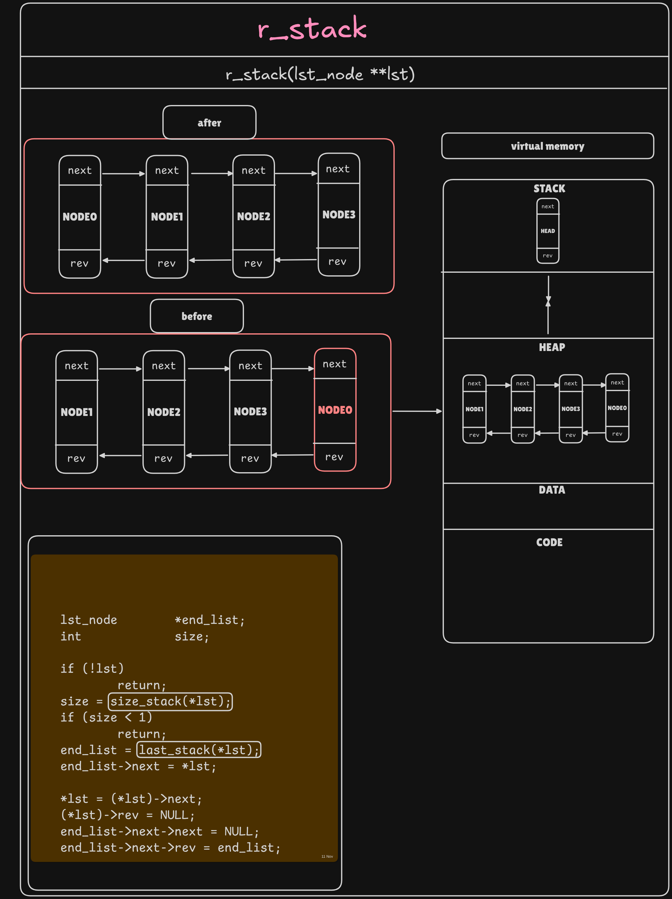
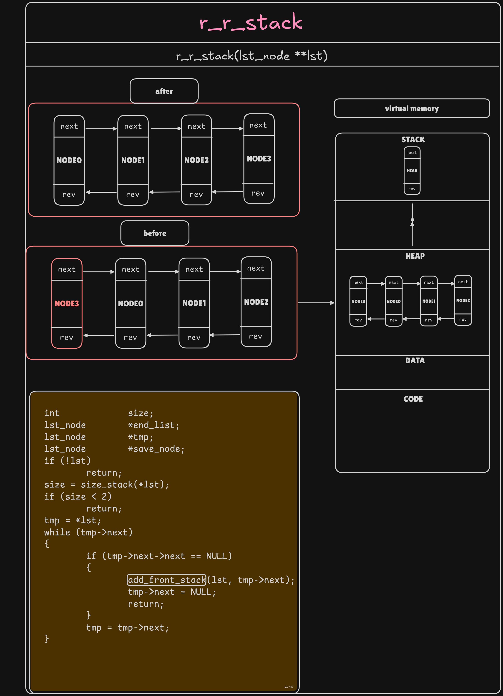

*This project has been created as part of the 42 curriculum by heal-ans anarbia

# Chapter VI — Mandatory Part

## VI.1 Group Project Requirements

- This project must be completed by exactly 2 learners working together.
- Both learners must contribute meaningfully to the project and understand all implemented algorithms.
- The repository must clearly indicate both learners’ contributions in the README.md file.
- During the defense, both learners must be present and able to explain any part of the code.
- The project submission should include both learners’ logins in the repository.

## VI.2 The Rules

- You have 2 stacks named `a` and `b`.
- At the beginning:
  - The stack `a` contains a random amount of negative and/or positive numbers without any duplicate.
  - The stack `b` is empty.
- The goal is to sort numbers in ascending order into stack `a`. To do so, you have the following operations at your disposal:

### Swap Operations

- **sa (swap a):** Swap the first two elements at the top of stack `a`. Do nothing if there is only one or no elements.
- **sb (swap b):** Swap the first two elements at the top of stack `b`. Do nothing if there is only one or no elements.
- **ss:** `sa` and `sb` at the same time.

### Push Operations

- **pa (push a):** Take the first element at the top of `b` and put it at the top of `a`. Do nothing if `b` is empty.
- **pb (push b):** Take the first element at the top of `a` and put it at the top of `b`. Do nothing if `a` is empty.

### Rotate Operations

- **ra (rotate a):** Shift up all elements of stack `a` by one. The first element becomes the last one.
- **rb (rotate b):** Shift up all elements of stack `b` by one. The first element becomes the last one.
- **rr:** `ra` and `rb` at the same time.

### Reverse Rotate Operations

- **rra (reverse rotate a):** Shift down all elements of stack `a` by one. The last element becomes the first one.
- **rrb (reverse rotate b):** Shift down all elements of stack `b` by one. The last element becomes the first one.
- **rrr:** `rra` and `rrb` at the same time.

## VI.3 Algorithm Requirements

To enforce a rigorous understanding of algorithmic complexity (time and space), you must implement four distinct sorting strategies and integrate them into your `push_swap` program. Your program must be able to select a strategy at runtime based on the input configuration.

### VI.3.1 Complexity Model and Operation Constraints

All strategies are implemented in C and must generate sequences of Push_swap operations to perform the sorting. This means:

- Your C algorithms analyze the input and generate the appropriate sequence of operations: `sa`, `sb`, `ss`, `pa`, `pb`, `ra`, `rb`, `rr`, `rra`, `rrb`, `rrr`.
- The output of your strategy is the sequence of these operations that sorts the stack.
- When you state a complexity class, it must reflect the cost measured in number of Push_swap operations generated, not the theoretical complexity of a classical array-based algorithm.

### VI.3.2 Disorder Metric (Mandatory)

In this subject, disorder is a number between 0 and 1 that tells how far your initial stack `a` is from being sorted.

If the numbers are already in the right order, the disorder is 0. If the numbers are in the worst possible order, the disorder is 1. Anything in between means your stack is partly sorted, but still messy.

To calculate it, you can think of looking at all the possible pairs of numbers in the stack. Each time a bigger number appears before a smaller one, that pair counts as a mistake. The more mistakes you have, the closer the disorder is to 1.

**Disorder calculation:**

```text
function compute_disorder(stack a):
    mistakes = 0
    total_pairs = 0

    for i from 0 to size(a)-1:
        for j from i+1 to size(a)-1:
            total_pairs += 1
            if a[i] > a[j]:
                mistakes += 1

    return mistakes / total_pairs
```

You must measure the disorder before doing any moves.

### VI.3.3 Required Strategies

**1. Simple Algorithm (O(n²))**

Implement at least one baseline algorithm in the O(n²) class. Examples include:

- Insertion sort adaptation
- Selection sort adaptation
- Bubble sort adaptation
- Simple min/max extraction methods

**2. Medium Algorithm (O(n√n))**

Implement at least one algorithm in the O(n√n) class. Examples include:

- Chunk-based sorting (divide into √n chunks)
- Block-based partitioning methods
- Bucket sort adaptations with √n buckets
- Range-based sorting strategies

**3. Complex Algorithm (O(n log n))**

Implement at least one algorithm in the O(n log n) class. Examples include:

- Radix sort adaptation (LSD or MSD)
- Merge sort adaptation using two stacks
- Quick sort adaptation with stack partitioning
- Heap sort adaptation
- Binary indexed tree approaches

**4. Custom Adaptive Algorithm (Learner's Design)**

Design an adaptive strategy that selects different internal methods depending on the measured disorder. You are not constrained to any specific named algorithm; the internal techniques are entirely up to you. However, your design must respect the following complexity targets per regime (in the Push_swap operation model):

- **Low disorder:** if disorder < 0.2, your chosen method must run in O(n²) time.
- **Medium disorder:** if 0.2 ≤ disorder < 0.5, your chosen method must run in O(n√n) time.
- **High disorder:** if disorder ≥ 0.5, your chosen method must run in O(n log n) time.

You must document in your repository (e.g., README.md) the rationale for your thresholds, the internal techniques used in each regime, and a brief complexity argument (upper bounds) for time and space within the Push_swap model.

## VI.4 Example

To illustrate the effect of some of these operations, let's sort a random list of integers. In this example, we'll consider that both stacks grow from the right.

### Init a and b

```text
    a       b
    2       _
    1       _
    3       _
    6       _
    5       _
    8       _
```

### Exec sa

```text
    a       b
    1       _
    2       _
    3       _
    6       _
    5       _
    8       _
```

### Exec pb pb pb

```text
    a       b
    6       3
    5       2
    8       1
    _       _
```

### Exec ra rb (equivalent to rr)

```text
    a       b
    5       2
    8       1
    6       3
```

### Exec rra rrb (equivalent to rrr)

```text
    a       b
    6       3
    5       2
    8       1
```

### Exec sa

```text
    a       b
    5       3
    6       2
    8       1
```

### Exec pa pa pa

```text
    a       b
    1       _
    2       _
    3       _
    5       _
    6       _
    8       _
```

The integers in stack `a` get sorted in 12 operations. Can you do better?

## VI.5 The `push_swap` Program

| Item | Description |
|---|---|
| Program Name | `push_swap` |
| Files to Submit | Makefile, `*.h`, `*.c` |
| Makefile | `NAME`, `all`, `clean`, `fclean`, `re` |
| Arguments | Stack `a`: A list of integers |
| External Functions | `read`, `write`, `malloc`, `free`, `exit`, `ft_printf` or any equivalent YOU coded |
| Libft Authorized | Yes |
| Description | Sort stacks |

Your project must comply with the following rules:

- You have to turn in a Makefile which will compile your source files. It must not relink.
- Global variables are forbidden.
- You must write a program named `push_swap` that takes as arguments:

  - The stack `a` formatted as a list of integers (the first argument is the top of the stack).
  - An optional strategy selector:

    - `--simple`: Forces the use of your O(n²) algorithm.
    - `--medium`: Forces the use of your O(n√n) algorithm.
    - `--complex`: Forces the use of your O(n log n) algorithm.
    - `--adaptive`: Forces the use of your adaptive algorithm based on disorder.

    This is the default behavior if no selector is given.

- The program must display the smallest list of Push_swap operations possible to sort stack `a`, the smallest number being at the top.
- Operations must be separated by a `\n` and nothing else.
- The complexity class claimed for each algorithm must be valid in this model.
- The strategy selection must work for all valid inputs. Any selector flag should work regardless of input size or disorder.
- If no parameters are specified, the program must not display anything and give the prompt back.
- In case of error, it must display `"Error"` followed by a `\n` on the standard error. Errors include, for example, arguments that are not integers, integers outside the valid range, or duplicate values.
- Your binary must embed all four strategies (Simple O(n²), Medium O(n√n), Complex O(n log n), and Adaptive). The selected strategy name and complexity class must be available in `--bench` mode.
- The optional benchmark mode (`--bench`) must display, after sorting:

  - The computed disorder (% with two decimals).
  - The name of the strategy used and its theoretical complexity class.
  - The total number of operations.
  - The count of each operation type (`sa`, `sb`, `ss`, `pa`, `pb`, `ra`, `rb`, `rr`, `rra`, `rrb`, `rrr`).

  The benchmark output must be sent to stderr and only appear when the flag is present.

### VI.5.1 Usage Examples

Notation: lines prefixed with `[bench]` represent messages printed by the optional benchmark mode (to stderr). The operation stream remains on stdout.

**Default selection (`--adaptive`) and operation count:**

```bash
$> ./push_swap 2 1 3 6 5 8
ra
pb
rra
pb
pb
ra
pb
ra
pb
pb
pa
pa
pa
pa
pa
pa
```

```bash
$> ARG="4 67 3 87 23"; ./push_swap --adaptive $ARG | wc -l
13
```

**Force the simple (O(n²)) strategy:**

```bash
$> ./push_swap --simple 5 4 3 2 1
rra
pb
rra
pb
rra
pb
ra
pb
pb
pa
pa
pa
pa
pa
```

**Force the complex (O(n log n)) strategy and verify with the checker:**

```bash
$> ARG="4 67 3 87 23"; ./push_swap --complex $ARG | ./checker_linux $ARG
OK
```

**Push_swap with a large input:**

```bash
$> shuf -i 0-9999 -n 500 > args.txt
$> ./push_swap $(cat args.txt) | wc -l
6784
```

**Error management examples:**

```bash
$> ./push_swap --adaptive 0 one 2 3
Error

$> ./push_swap --simple 3 2 3
Error
```

## VI.6 Performance Benchmark

To validate this project, you must achieve certain performance targets with a minimal number of operations:

### 100 Random Numbers

- **Less than 2000 operations:** Minimum requirement.
- **Less than 1500 operations:** Good performance.
- **Less than 700 operations:** Excellent performance.

### 500 Random Numbers

- **Less than 12000 operations:** Minimum requirement.
- **Less than 8000 operations:** Good performance.
- **Less than 5500 operations:** Excellent performance.
---
### Swap Operations

### Push Operations

### Rotate Operations

### Reverse Rotate Operations

